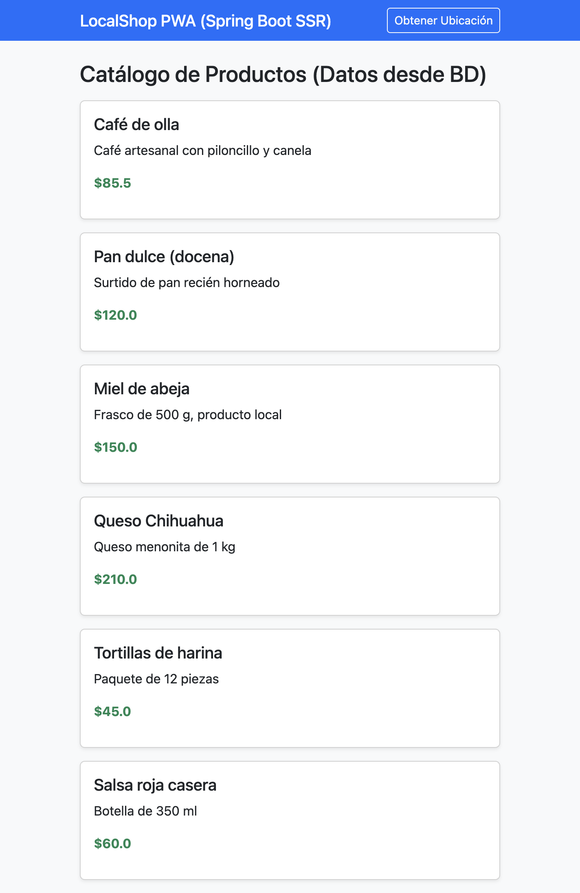
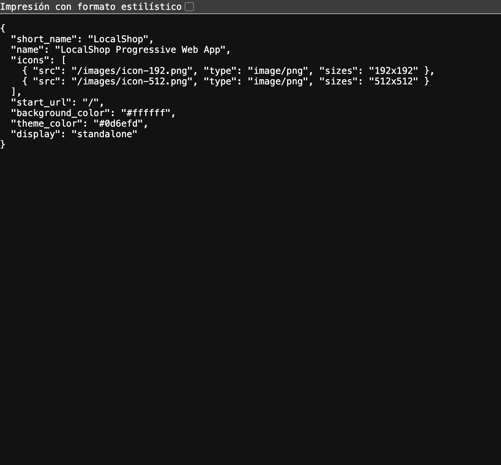
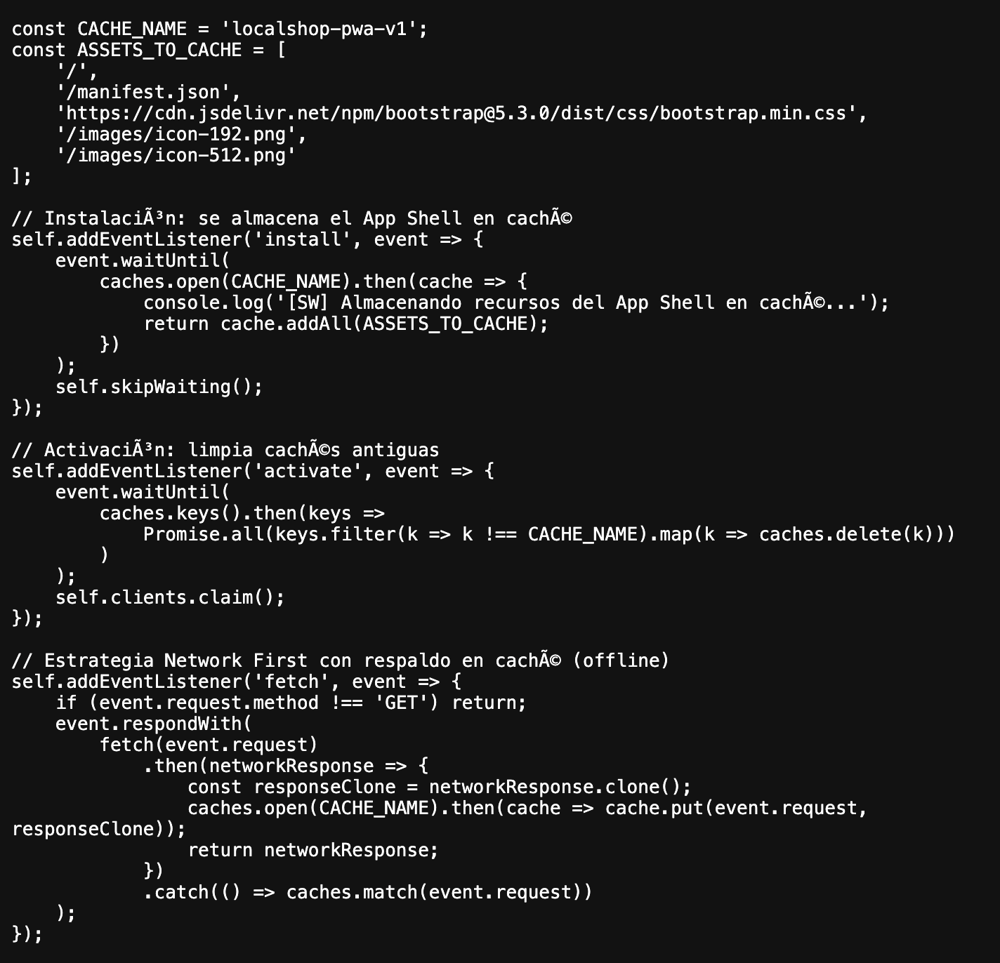

# LocalShop PWA 

Práctica-4: Desarrollo PWA-SSR — Grupo 102-03, UTCH.

## Autores
- Luis Manuel Batista Bustillos
- Sheila Sarahi Santoyo Parga
- Luisangely Mora Valera
- Genaro Cedillo 
- Sebastian Garcia 
- Armando Baca

## Descripción
Aplicación Web Progresiva (PWA) con renderizado del lado del servidor (SSR) usando **Java 17**, **Spring Boot 3**, **Thymeleaf** y **Spring Data JPA**. Incluye manifiesto web, Service Worker con caché para uso offline, arquitectura App Shell y acceso a la API de Geolocalización.

## Estructura (MVC)
```
src/main/java/com/pwa/localshop
├── LocalShopApplication.java
├── model/Producto.java
├── repository/ProductoRepository.java
├── controller/ProductoController.java
└── config/DataLoader.java        (datos de ejemplo)
src/main/resources
├── application.properties
├── templates/index.html          (vista SSR - App Shell)
└── static/ (manifest.json, sw.js, images/)
```

## Ejecución local
Requisitos: JDK 17+, Maven 3.9+, Git, Google Chrome.

```bash
git clone <URL_DEL_REPOSITORIO>
cd localshop-pwa
mvn spring-boot:run
```
Abrir http://localhost:8080 (consola H2: http://localhost:8080/h2-console, JDBC URL `jdbc:h2:mem:localshopdb`, usuario `sa`).

Para usar PostgreSQL, editar `application.properties` (hay una sección comentada).

## Fases de desarrollo

### Etapa 1: Base de datos y modelo (SSR Back-End)
Entidad `Producto` (JPA), `ProductoRepository` y `ProductoController`, que inyecta los datos en la vista Thymeleaf. `DataLoader` inserta productos de ejemplo.


### Etapa 2: Componentes PWA (Manifiesto y App Shell)
`manifest.json` con nombre, iconos, `start_url`, colores y `display: standalone`. La vista `index.html` es el App Shell (navbar + catálogo renderizado en el servidor + botón de geolocalización).




### Etapa 3: Service Worker y soporte offline
`sw.js` guarda el App Shell en caché durante `install`, limpia cachés viejas en `activate` y usa estrategia *Network First* con respaldo en caché en `fetch`.




### Geolocalización
El botón "Obtener Ubicación" usa `navigator.geolocation` y muestra latitud y longitud.


### Auditoría Lighthouse (opcional)

